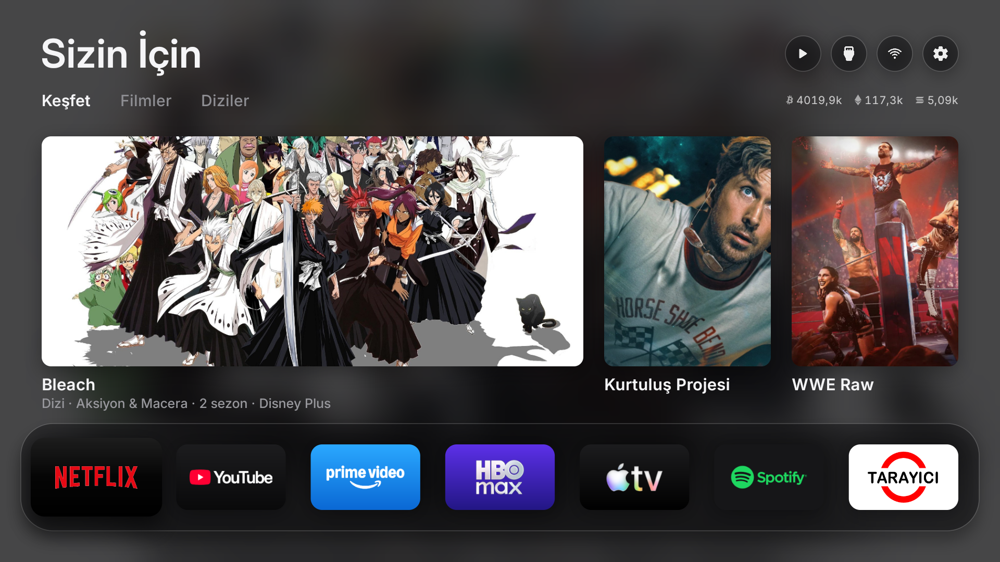

# CleanYourTV-UI (Türkçe & TMDB Destekli Android TV Başlatıcı)

Hafif, reklamsız, akıcı ve televizyonunuzun orijinal sistem servislerine zarar vermeyen modern Android TV başlatıcısı (Launcher).

<p align="center">
  
</p>

> **Kaynak & Teşekkür (Credits):**  
> Bu proje, **[Matheus Caldeira (matheus-caldeira/cleanyourtv-ui)](https://github.com/matheus-caldeira/cleanyourtv-ui)** tarafından geliştirilen harika `cleanyourtv-ui` çalışmasının Türkçe yerelleştirilmiş, saat/hava durumu göstergesi eklenmiş ve Türkiye için optimize edilmiş sürümüdür. Matheus Caldeira'ya açık kaynak katkısı için teşekkür ederiz.

---

## İçindekiler
- [Bu Başlatıcı Ne İşe Yarar?](#bu-başlatıcı-ne-işe-yarar)
- [Öne Çıkan Özellikler](#öne-çıkan-özellikler)
- [Cihaz Uyumluluk Bildirimi](#cihaz-uyumluluk-bildirimi)
- [Adım Adım Kurulum Rehberi](#adım-adım-kurulum-rehberi)
- [Yapay Zeka (AI) ile Otomatik Kurulum Promptu](#yapay-zeka-ai-ile-otomatik-kurulum-promptu)
- [Yapılandırma (config.properties)](#yapılandırma-configproperties)
- [Hata Bildirimi ve Destek](#hata-bildirimi-ve-destek)
- [Lisans](#lisans)

---

## Bu Başlatıcı Ne İşe Yarar?
CleanYourTV-UI, Android TV ve Google TV cihazlarındaki reklam dolu, yavaş ve karmaşık fabrika ana ekranlarının yerine geçen ultra hafif ve modern bir ev ekranıdır.

Orijinal televizyon sistem servislerine veya fabrika uygulamalarına zarar vermez (`no debloat`). Cihazınızı yormadan, Apple TV sadeliğinde akıcı bir film, dizi ve uygulama deneyimi sunar.

---

## Öne Çıkan Özellikler
- **Sağ Üst Dijital Saat ve Sıcaklık Göstergesi:** Ana ekranın sağ üst köşesinde, ayar butonlarının hemen yanında her dakika güncellenen şık dijital saat ve yerel hava sıcaklığı.
- **Sağ Üst Wi-Fi Hızlı Erişim Butonu:** TV'nin yerel ağ ve kablosuz bağlantı ayarları ekranını (`NetworkActivity`) tek tuşla açan özel buton.
- **Tam Türkçe Arayüz:** Tüm ayarlar, menüler, kategoriler, hava durumu durumları ve film/dizi türleri (`Aksiyon & Macera`, `Dizi`, `Film`, `Belgesel` vb.) eksiksiz Türkçeleştirildi.
- **TMDB Türkiye Optimizasyonu (`tr-TR` / `TR`):** Ana sayfadaki 3 vitrin kartında Türkçe yerel başlığı bulunan popüler içerikler önceliklendirilir.
- **Döviz ve Piyasa Göstergesi:** Kripto ve piyasa verilerinde Türk Lirası (`₺`) desteği.
- **Sıfır Donma & Minimum RAM Tüketimi:** Arka planda telemetri, reklam servisi veya gereksiz animasyon yükü barındırmaz.
- **Güvenli Varsayılan:** Orijinal başlatıcıyı silmez veya bozmaz; Android TV standart `cmd package set-home-activity` ile çalışır. İstediğiniz an fabrika arayüzüne geri dönebilirsiniz.

---

## Cihaz Uyumluluk Bildirimi
- **Bizzat Test Edilip Doğrulanan Model:**  
  **Philips 58PUS8507/12 (58PUS8507/62, Android TV 11)** — TMDB öneri kartları, Türkçe menüler, sağ üst dijital saat ve sıcaklık göstergesi, Wi-Fi hızlı ayar butonu ve akıcı kumanda navigasyonu test edilmiş ve tam kararlılıkla çalıştığı doğrulanmıştır.
- **Diğer Cihazlar:**  
  Android TV 9, 10, 11, 12, 13 ve 14 çalıştıran tüm akıllı televizyon ve TV kutuları (Sony, TCL, Xiaomi Mi Box / TV Stick, Chromecast with Google TV, Onn vb.) için tasarlanmıştır.  
  > [!IMPORTANT]
  > Farklı televizyon üreticilerinin uyguladığı özel sistem kısıtlamaları ve launcher politikaları nedeniyle **her marka ve modelde %100 sorunsuz çalışma garantisi verilemez**. Lütfen kendi cihazınızda test edip deneyimlerinizi Issues bölümünde paylaşın!

---

## Adım Adım Kurulum Rehberi

### 1. Televizyonda ADB Hata Ayıklamayı Açma
1. Televizyonunuzda **Ayarlar (Settings)** -> **Cihaz Tercihleri** -> **Hakkında** bölümüne gidin.
2. **Android TV Derlemesi (Build)** seçeneğine kumandanın **OK** tuşuyla **7 kez** arka arkaya basın (*"Artık bir geliştiricisiniz"* bildirimi çıkana kadar).
3. Geri gelip **Geliştirici Seçenekleri** menüsüne girin ve **USB Hata Ayıklama (USB Debugging)** seçeneğini açın.
4. **Ayarlar** -> **Ağ ve İnternet** kısmından TV'nizin yerel IP adresini not edin (örnek: `192.168.1.50`).

### 2. Uygulamayı Televizyona Yükleme ve Varsayılan Yapma

#### Yöntem A: Hazır APK Dosyasını İndirerek (En Hızlısı)
1. [Releases](https://github.com/ichZara/CleanYourTV-UI-TR/releases) sayfasından `CleanYourTV-UI.apk` dosyasını indirin.
2. Bilgisayarınızda terminal veya PowerShell açıp şu komutları çalıştırın:
   ```bash
   # Televizyona Wi-Fi üzerinden bağlanın:
   adb connect <TELEVIZYON_IP_ADRESI>:5555
   # (TV ekranına 'Bu bilgisayara her zaman izin verilsin mi?' kutusu gelir; kumandayla 'Her zaman izin ver'i seçip OK deyin)

   # APK'yı televizyona kurun:
   adb install -r CleanYourTV-UI.apk

   # Televizyonun varsayılan ana ekranı (Home) yapın:
   adb shell cmd package set-home-activity io.cleanyourtv.ui/.HomeActivity
   ```

#### Yöntem B: Kaynak Koddan Derleyerek
```bash
git clone https://github.com/ichZara/CleanYourTV-UI-TR.git
cd CleanYourTV-UI-TR/launcher-ui
./build.sh
adb connect <TELEVIZYON_IP_ADRESI>:5555
adb install -r CleanYourTV-UI.apk
adb shell cmd package set-home-activity io.cleanyourtv.ui/.HomeActivity
```

---

## Yapay Zeka (AI) ile Otomatik Kurulum Promptu
ADB komutlarıyla uğraşmak istemiyorsanız, aşağıdaki promptu kullandığınız yapay zeka asistanına (ChatGPT, Claude, Gemini veya terminal AI aracınıza) vererek kurulumu baştan sona ona yaptırabilirsiniz:

````markdown
Aşağıdaki GitHub deposunu kullanarak Android TV'me hafif, reklamsız ve Türkçe CleanYourTV başlatıcısını kurmak istiyorum:
Repo: https://github.com/ichZara/CleanYourTV-UI-TR
Televizyonumun yerel IP adresi: [BURAYA_TELEVIZYONUN_IP_ADRESINI_YAZIN, örn: 192.168.1.50]

Lütfen şu adımları benim için sırasıyla açıkla veya terminal komutlarıyla çalıştır:
1. Depodaki son sürüm APK'yı (CleanYourTV-UI.apk) indir veya depoyu klonlayıp derle.
2. Bilgisayarımdan ADB ile yukarıdaki televizyon IP adresine bağlan.
3. APK'yı televizyona yükle ve televizyonun varsayılan ana ekranı olarak ayarla.
4. Hata alırsam (örneğin cihaz bulunamadı veya bağlantı reddedildi) nasıl düzelteceğimi belirt.
````

---

## Yapılandırma (`config.properties`)
İsteğe bağlı olarak `launcher-ui/config.properties` dosyasına kendi ücretsiz TMDB API anahtarınızı tanımlayabilirsiniz:

```properties
tmdb.key=BURAYA_TMDB_API_KEY
language=tr
region=TR
```

---

## Hata Bildirimi ve Destek
Herhangi bir hata, çökme veya görsel sorun yaşarsanız lütfen **[GitHub Issues](https://github.com/ichZara/CleanYourTV-UI-TR/issues)** üzerinden bize bildirin!  
Hata bildirirken televizyonunuzun **markasını, tam model kodunu ve Android sürümünü** yazmanız sorunun hızla giderilmesini sağlayacaktır.

---

## Lisans
Açık kaynaklıdır. Orijinal `matheus-caldeira/cleanyourtv-ui` lisansına tabidir.

---

## Diğer Projeler
Geliştirdiğim diğer açık kaynaklı Android TV ve akıllı ev projelerine göz atmak için **[GitHub Profilimi (@ichZara)](https://github.com/ichZara)** ziyaret edebilirsiniz.
